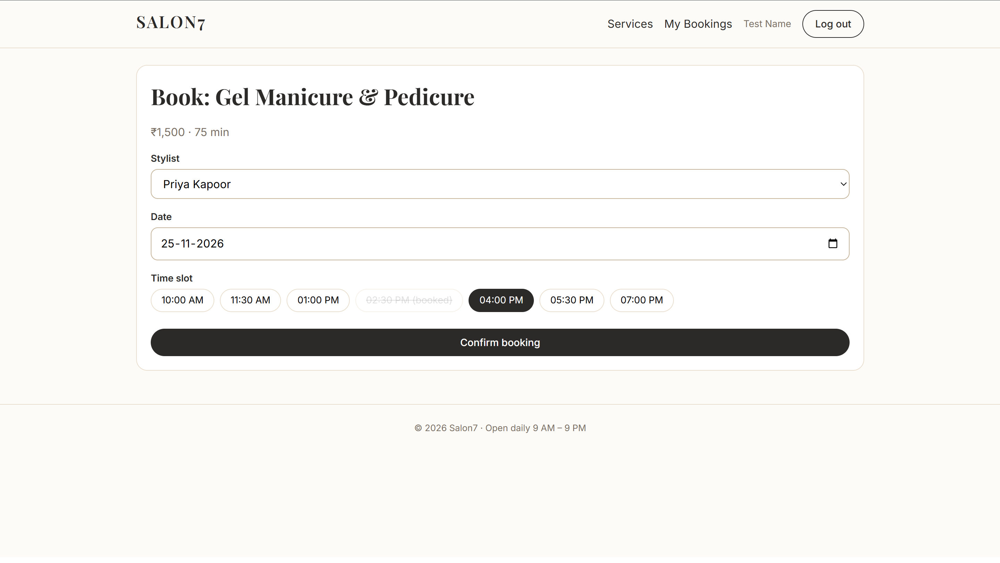
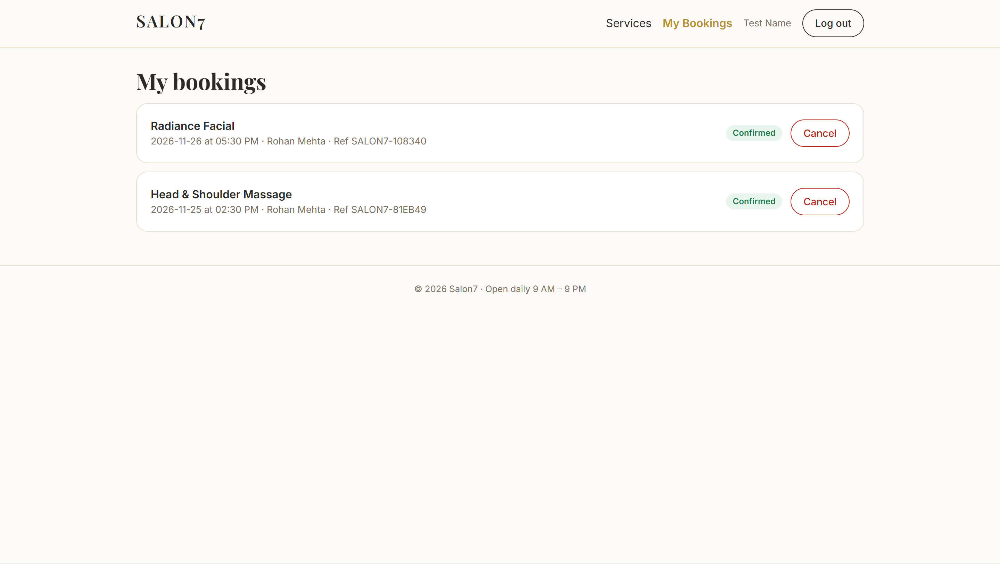
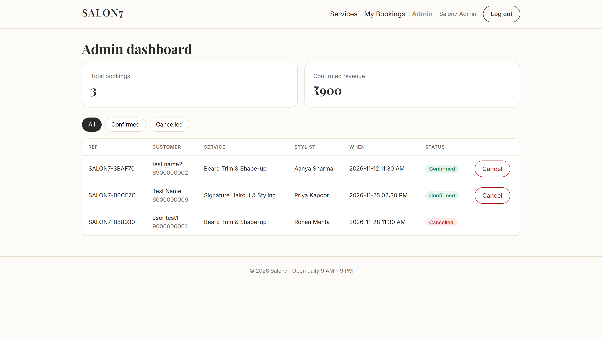

# Salon7

Salon appointment booking site. Customers browse services and book a stylist, date and time slot; the admin views and cancels bookings. (Digi SkyUp project W1.)

- **Live URL:** https://salon7web.onrender.com
- **Health check:** https://salon7web.onrender.com/api/health

## Screenshots






## Features

- Services page with search and category filter
- Register / log in with validated forms (client and server)
- Booking flow: service → stylist → date → time slot → confirmation reference
- Booked slots are disabled in the UI, and a unique MongoDB index also rejects double bookings
- "My bookings" where customers cancel their own bookings
- Admin dashboard: all bookings, status filter, cancel, totals
- Loading, empty, error and offline states; responsive on mobile, tablet and desktop

## Tech stack and why

| Part | Choice | Why |
|---|---|---|
| Database | MongoDB Atlas (M0 free) | Hosted, free, does not expire |
| Server | Node.js + Express + Mongoose | Simple REST API with schema validation |
| Frontend | React (JSX) + plain HTML/CSS, built with Vite | Vite only compiles JSX; no UI or routing libraries |
| Login | JWT + bcrypt | Stateless and simple |
| Hosting | Render (one free web service) | Express serves the built React app, so there is one deploy, no CORS and no frontend env file |
| Monitoring | UptimeRobot (free) | Pings /api/health every 5 minutes, so the site stays awake and I get an alert if it goes down |

## Folder structure

```
salon7/
├── package.json        scripts that run both parts
├── server/             Node + Express + MongoDB
│   ├── server.js  models/  routes/  middleware/  utils/  scripts/seed.js
└── client/             React JSX + CSS
    └── src/  pages/  components/  context/  lib/ (api.js, router.jsx)
```

## Local setup

Requires Node 18+ and a free MongoDB Atlas cluster (Atlas → Network Access: allow your IP).

```bash
cp server/.env.example server/.env     # fill in MONGODB_URI, JWT_SECRET, ADMIN_EMAIL, ADMIN_PASSWORD
npm run install:all
npm run seed                           # sample services + admin account
```

Then run two terminals:

```bash
npm run dev:server     # API on http://localhost:5000
npm run dev:client     # site on http://localhost:5173 (proxies /api to the server)
```

Open http://localhost:5173. No client `.env` is needed.

To test the production setup locally: `npm run build` then `npm start`, and open http://localhost:5000.

## Environment variables (server/.env)

| Name | Description |
|---|---|
| `PORT` | Server port (Render sets it) |
| `MONGODB_URI` | Atlas connection string including `/salon7` |
| `JWT_SECRET` | Long random string for signing tokens |
| `ADMIN_EMAIL`, `ADMIN_PASSWORD` | Used only by `npm run seed` to create the admin |

## Test credentials

No passwords are committed. After seeding:

- **Admin:** the admin0@power.com / powerpass@1 you set in `server/.env`
- **User:** testmail@gmail.com / testpassword


## API overview

| Method | Path | Access |
|---|---|---|
| POST | `/api/auth/register`, `/api/auth/login` | public |
| GET | `/api/auth/me` | logged in |
| GET | `/api/services`, `/api/services/:id` | public |
| POST / PUT / DELETE | `/api/services` | admin |
| GET | `/api/bookings/slots` | logged in |
| POST | `/api/bookings` | logged in |
| GET | `/api/bookings/mine` | logged in |
| PATCH | `/api/bookings/:id/cancel` | owner or admin |
| GET | `/api/bookings` | admin |

## Scripts

`npm run install:all` · `dev:server` · `dev:client` · `build` · `start` · `seed` · `lint`

## Known limitations

- Render's free service sleeps after 15 minutes idle, so the first request can take 30–60 seconds.
- Slots are fixed (7 per day) and ignore service duration and stylist days off.
- Stylists are listed in `server/utils/config.js`.
- No email confirmation (stretch feature, not built).
- Services have admin API routes but no admin screen; edit them in Atlas or through the API.
- The rate limiter is in memory (resets on restart, works for one instance only).
- Login token is kept in localStorage.
- Page addresses use `/#/…` (hash routing) to avoid server rewrite rules.

## Future improvements

Email confirmations, admin service editor, stylist availability, reminders, payments.
